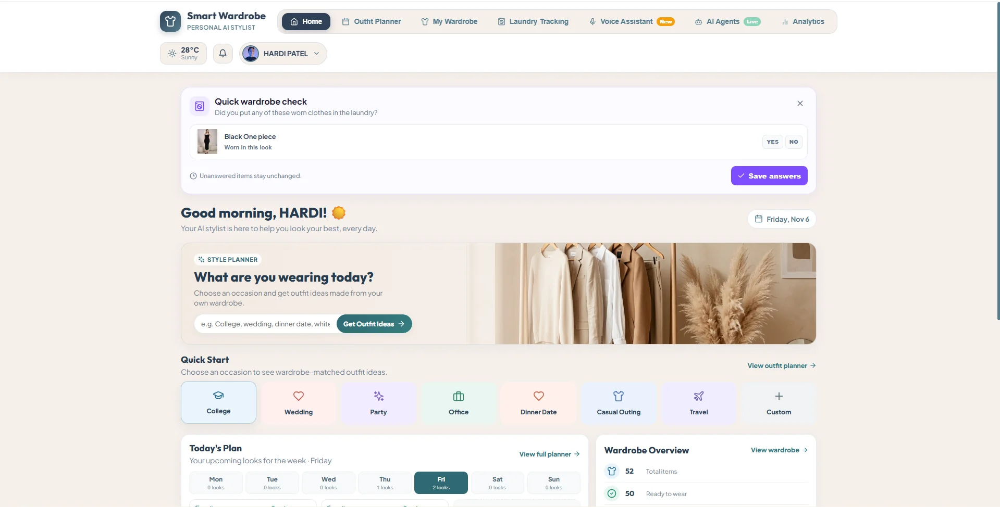
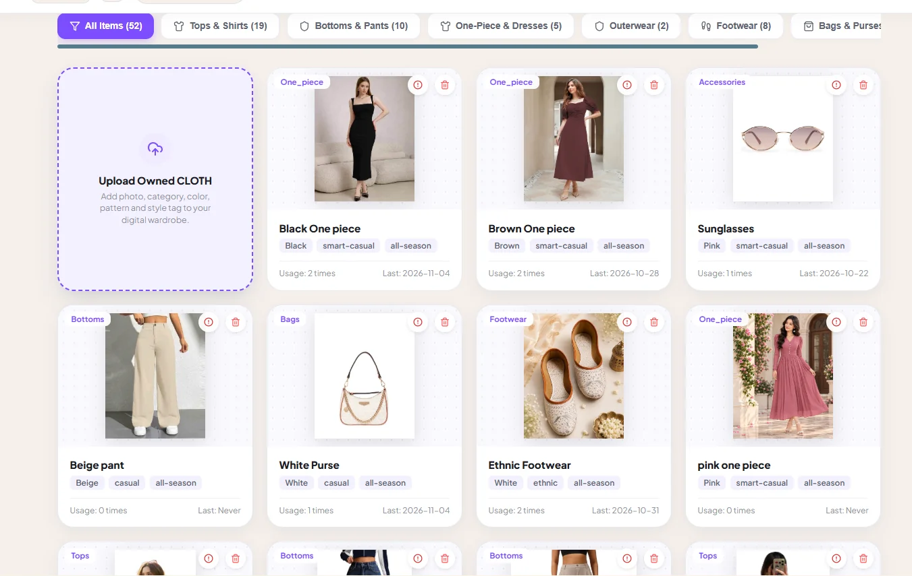
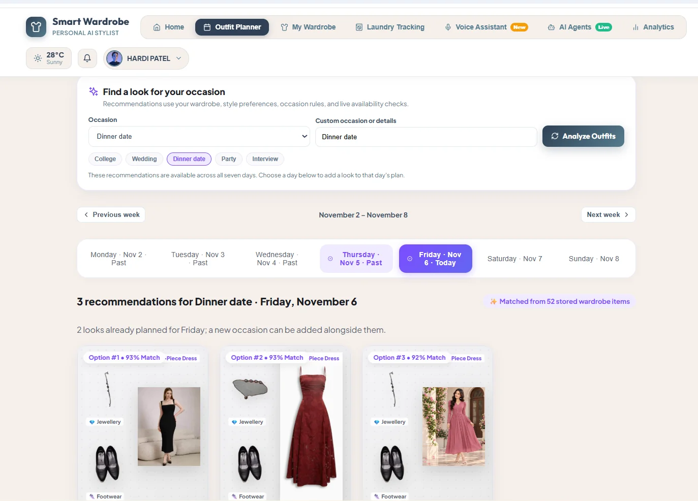
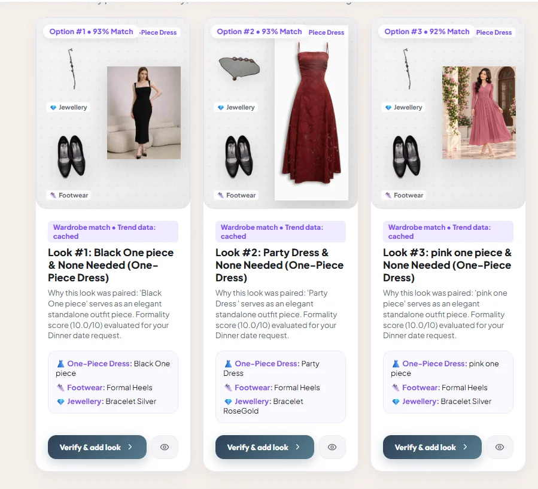
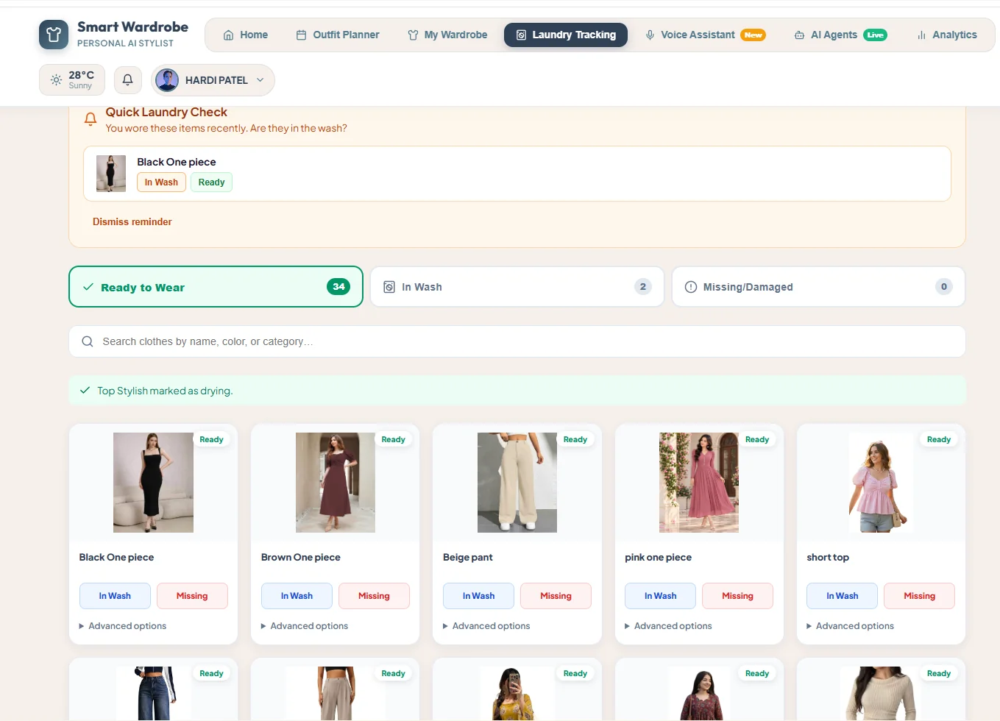
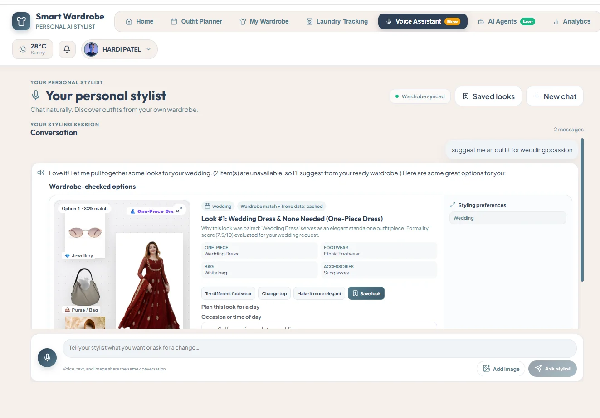
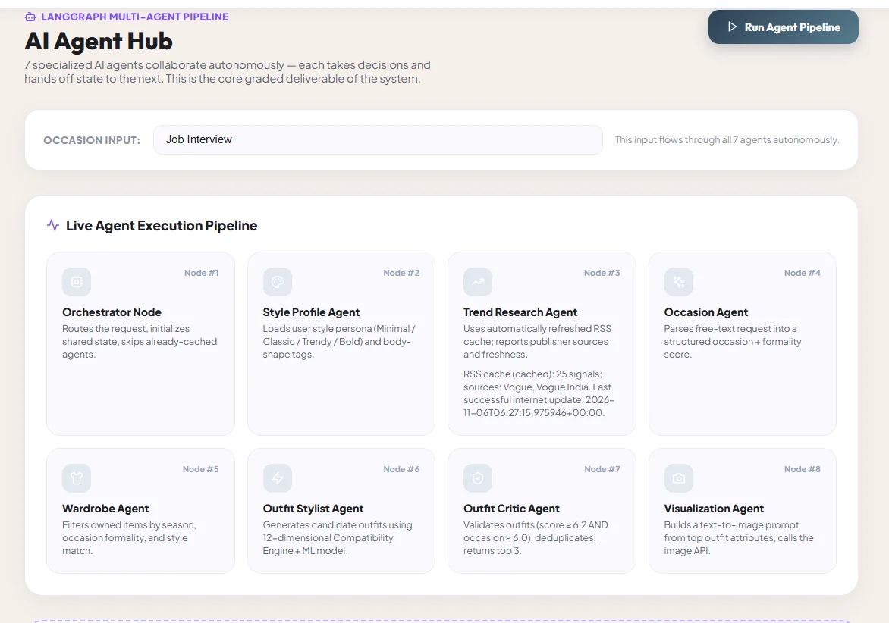
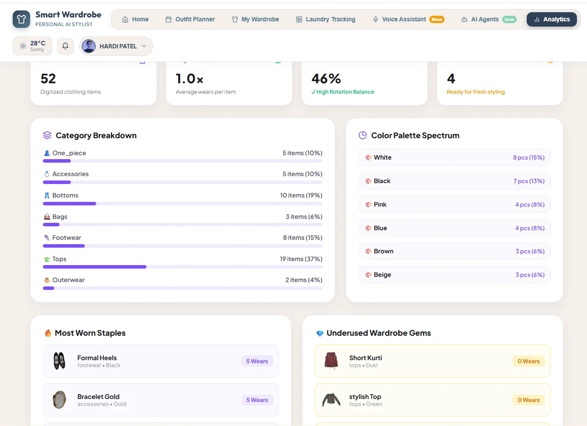
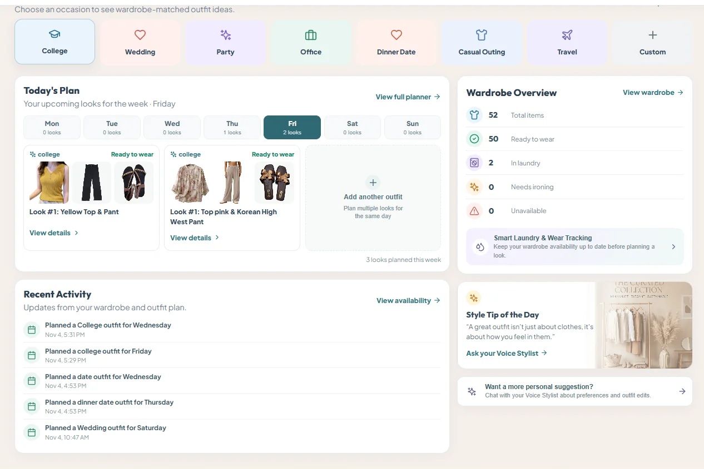
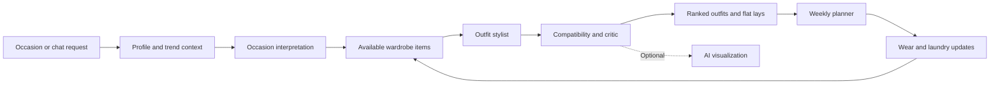

<div align="center">

# Smart Wardrobe · Personal AI Stylist

### Your wardrobe. Your style. Smarter outfit decisions.

A digital wardrobe and personal styling assistant that turns the clothes you already own into occasion-ready outfits.


[Features](#features) · [Screenshots](#screenshots) · [How it works](#how-it-works) · [Quick start](#quick-start)

</div>



## Overview

Choosing an outfit should start with what you own. Smart Wardrobe brings clothing inventory, outfit recommendations, weekly planning, laundry status, voice assistance, and wardrobe insights into one application.

**Add clothes → discover outfits → plan your week → record wear → update availability.**

## Features

| | What you can do |
| :-- | :-- |
| **Digital wardrobe** | Add, edit, delete, and browse garments by category, color, pattern, style, and season; inspect item details and wear history. |
| **Garment image tools** | Upload clothing photos, remove backgrounds, extract garment attributes, and request AI-assisted image processing where a provider is configured. |
| **Occasion-based styling** | Request looks for college, work, weddings, parties, dates, travel, or a custom occasion using saved wardrobe items. |
| **Outfit compatibility** | Rank combinations with a weighted 12-dimension fashion engine, styling rules, and an outfit critic. |
| **Personal preferences** | Collect profile and style preferences through onboarding and a preference assistant. |
| **Weekly outfit planner** | Navigate weeks, assign multiple looks to a day, replace plans, and check garment readiness before saving. |
| **Wear tracking** | Record worn outfits, maintain item usage history, and respond to post-wear laundry reminders. |
| **Laundry and availability** | Track ready, to-wash, in-wash, drying, damaged, missing, borrowed, and unavailable items, plus ironing states. |
| **Conversational stylist** | Ask for outfits, refine colors or garments, swap pieces, and manage saved looks with conversation context. |
| **Voice assistance** | Speak requests and hear responses using supported browser speech features; optionally enable OpenAI text-to-speech. |
| **Weather context** | Retrieve live weather through Open-Meteo to inform styling. |
| **Fashion trends** | Refresh configured RSS sources into a local trend cache and inspect source/update status. |
| **Agent Hub** | Inspect the styling stages, execution trace, and recommendation results. |
| **Analytics** | Explore category and color distribution, frequently worn pieces, and underused clothing. |
| **Account interface** | Register and sign in through the included authentication screens and backend endpoints. |
| **Outfit visuals** | View wardrobe flat lays immediately; optionally request provider-backed visualization. |

## Screenshots

The images below show the existing application with example wardrobe content. Optional AI integrations depend on your configuration.

| Digital wardrobe | Weekly planner |
| :--: | :--: |
|  |  |

| Outfit recommendations | Laundry tracking |
| :--: | :--: |
|  |  |

| Conversational stylist | Agent Hub |
| :--: | :--: |
|  |  |

| Wardrobe analytics | Dashboard overview |
| :--: | :--: |
|  |  |

## How it works



The backend runs specialized agent functions over shared styling state. The current recommendation entry point invokes these stages sequentially; LangGraph is included as a project dependency. Conversational requests have a separate workflow in `voice_agent_graph.py`.

The compatibility engine evaluates color, style, length, fit, silhouette, proportion, volume, occasion, formality, patterns, trends, and preference context. Displayed match scores are application ranking scores, not measured prediction accuracy. If no suitable ready-to-wear combination exists, the backend returns a no-match result.

## Technology

| Layer | Stack |
| :-- | :-- |
| Interface | React 18, Vite 5, CSS, Lucide icons |
| API | Python, FastAPI, Pydantic, Uvicorn |
| Styling | Specialized agent functions, compatibility engine, styling rules, ML compatibility component |
| Storage | SQLite, initialized automatically on backend startup |
| Images | Pillow, rembg, ONNX Runtime |
| AI providers | OpenRouter / OpenAI; Gemini support in the image stylist |
| Context | Open-Meteo weather, RSS feeds via feedparser |
| Speech | Browser speech APIs; optional OpenAI TTS |

## Quick start

### Requirements

- Python 3.10 or 3.11
- Node.js 20.19+ or 22.12+ and npm
- Git
- Internet access for provider-backed AI, weather, trend feeds, and remote images

Clone the repository, then open its folder:

```bash
git clone https://github.com/patelhardi123/Wardrob-Management-Personal-Styling-Agent-.git
cd Wardrob-Management-Personal-Styling-Agent-
```

### 1. Run the backend

```bash
cd backend
python -m venv .venv
```

Activate the environment:

```powershell
# Windows PowerShell
.\.venv\Scripts\Activate.ps1
```

```bash
# macOS / Linux
source .venv/bin/activate
```

Install dependencies and create your local configuration:

```bash
pip install -r requirements.txt
```

```powershell
# Windows PowerShell
Copy-Item .env.example .env
```

```bash
# macOS / Linux
cp .env.example .env
```

Edit `backend/.env` to configure the optional providers you want to use. See [the environment example](backend/.env.example) for the exact variable names. Core wardrobe storage and rule-based styling do not require an API key; provider-backed image understanding, commentary, and generation require their respective integrations. Some calls use fallbacks when a provider is unavailable.

Start the API from the `backend` directory:

```bash
uvicorn main:app --reload --port 8000
```

The server creates its local SQLite database and starts the trend refresh worker. The first background-removal operation may download model weights.

### 2. Run the frontend

Open a second terminal in the project folder:

```bash
cd frontend
npm ci
npm run dev
```

Open the address Vite prints, usually **http://localhost:5173**. API documentation is at **http://localhost:8000/docs**.

The frontend currently calls `http://localhost:8000` directly, so keep the backend on port 8000 for local use.

### 3. Try the workflow

1. Open the wardrobe and add a few tops, bottoms, and shoes.
2. Ask for a college, office, wedding, or custom occasion outfit.
3. Review the recommended combinations and save a look to the weekly planner.
4. Record wearing it and update the garments' laundry or ironing status.
5. Explore the Voice Assistant, Agent Hub, and Analytics pages.

## Project structure

```text
Wardrob/
├── backend/
│   ├── main.py                    # FastAPI routes and application lifecycle
│   ├── database.py                # SQLite schema, records, and authentication helpers
│   ├── agent_graph.py             # Outfit recommendation stages
│   ├── voice_agent_graph.py       # Conversational styling workflow
│   ├── gemini_stylist.py          # Image stylist provider integration
│   ├── trend_research.py          # RSS retrieval, caching, and refresh worker
│   ├── trend_sources.json         # Configured trend sources
│   ├── fashion/                   # Compatibility, image attributes, weather, LLM, speech
│   ├── test_*.py                  # Backend regression tests
│   ├── .env.example               # Safe configuration template
│   └── requirements.txt
├── frontend/
│   ├── src/components/            # Dashboard, wardrobe, planner, chat, and analytics
│   ├── src/utils/                 # Context parsing and frontend styling helpers
│   └── package.json
├── docs/screenshots/              # Application screenshots used above
└── README.md
```

## Development checks

```bash
# Frontend production build, from frontend/
npm run build

# Backend tests, from backend/ with the environment activated
python -m pytest
```

Tests cover authentication, availability, scheduling, database locking, styling, conversation behavior, and trend research. Run backend tests against a disposable local database or back up your own wardrobe data first.

## Current scope

This repository is a local development application. Several frontend workflows currently use `user_id=1`; complete account-to-data authorization before deploying it as a shared service. Production deployment also needs configured API URLs and restricted CORS. The legacy `docker-compose.yml` references MySQL and missing Dockerfiles; use the local setup above for this SQLite version.

API keys, local databases, environments, generated builds, and logs are excluded from version control. Screenshots are included for the project showcase. Browser voice support and external AI service availability vary.

## Contributing

Ideas and improvements are welcome through issues and pull requests. Describe the change and include relevant checks or interface screenshots.

## License

No license has been selected. A public repository does not by itself grant permission to reuse or redistribute the code.

---

<div align="center">

**Smarter outfits from the wardrobe you already own.**

</div>

